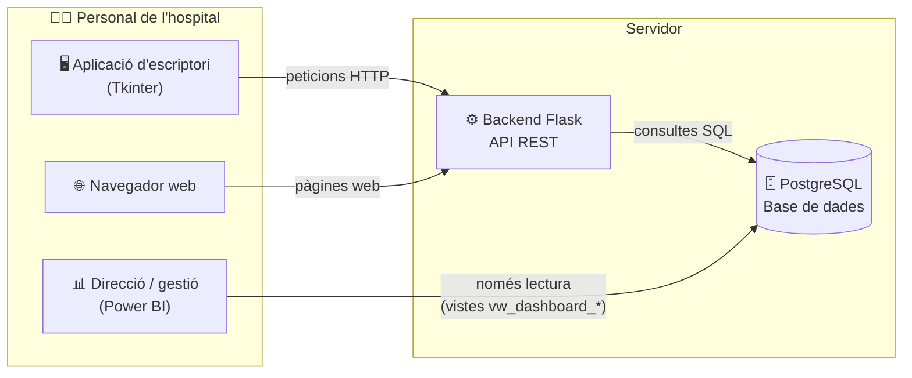
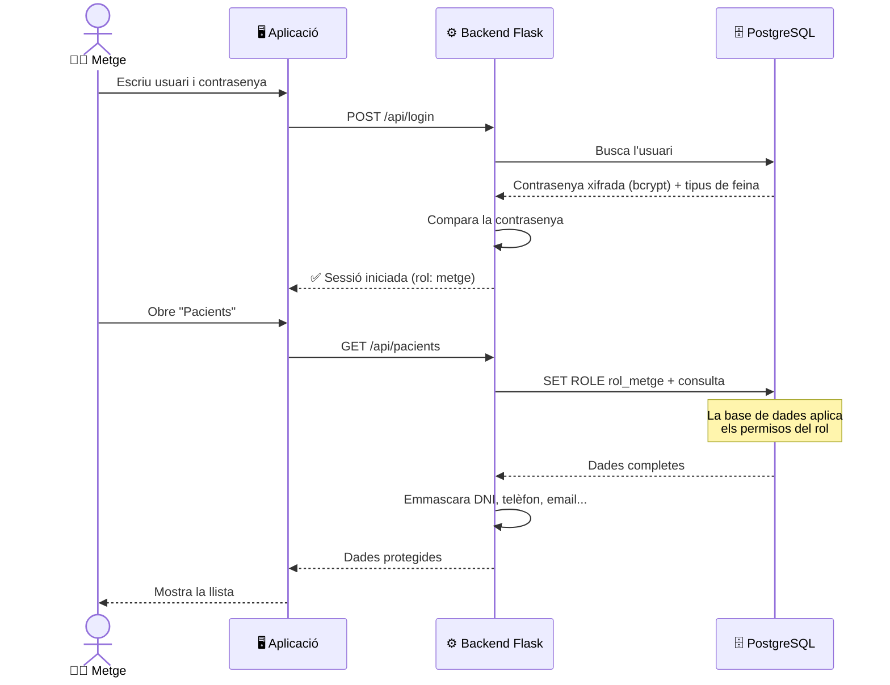
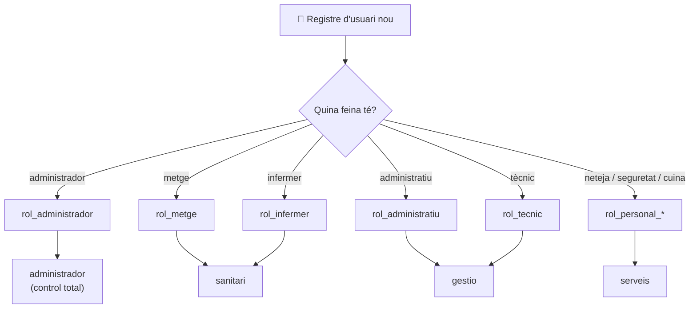
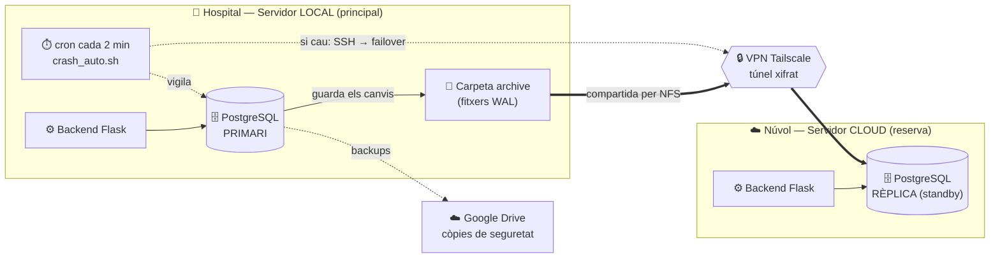
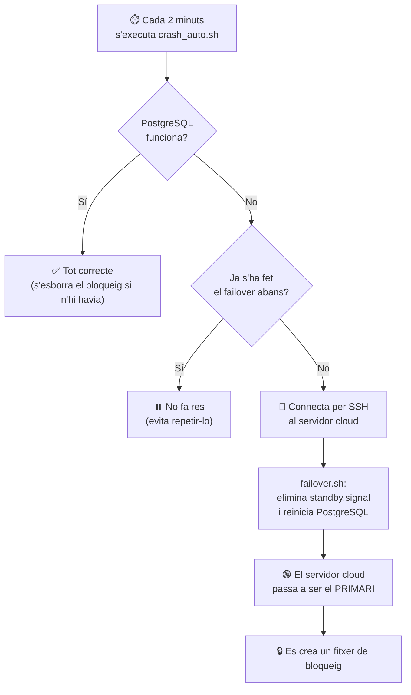
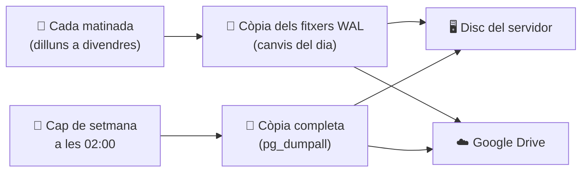
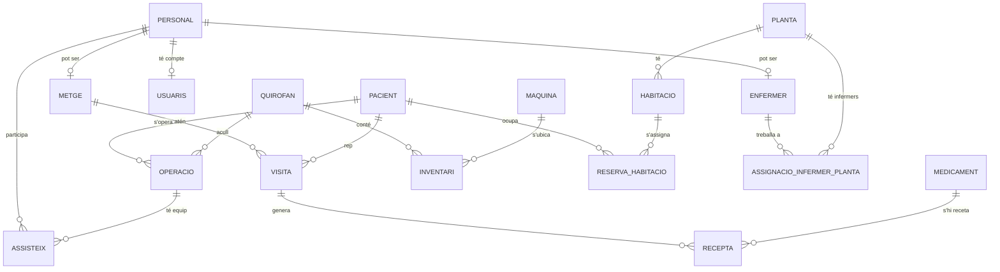
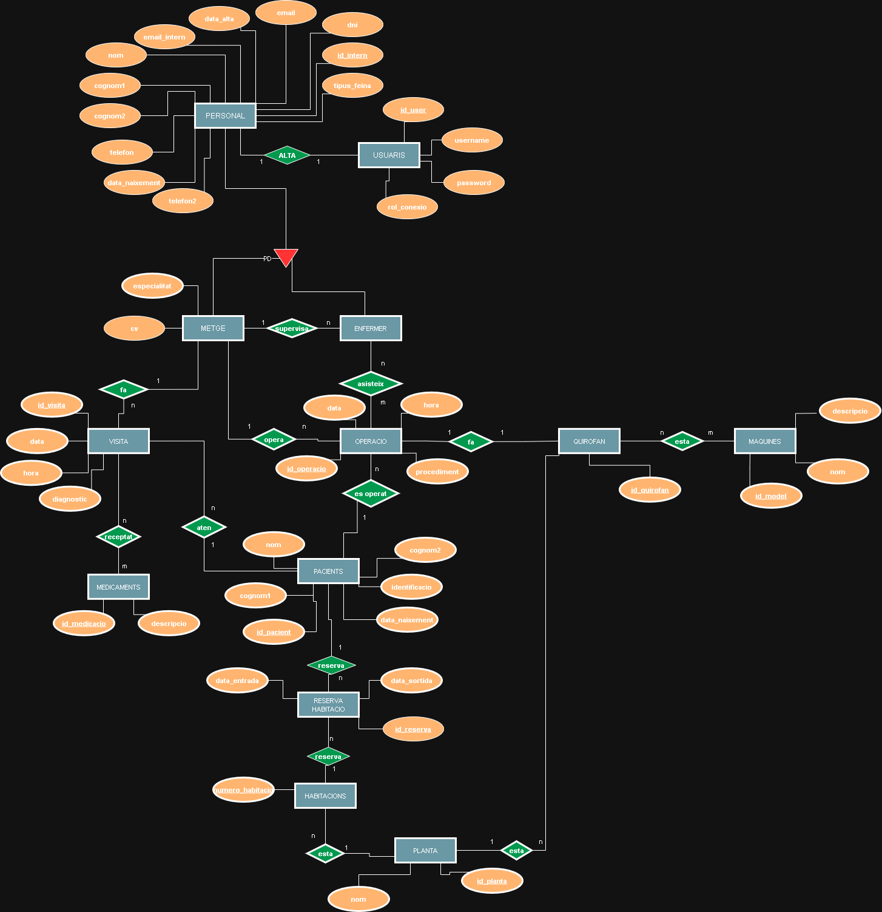
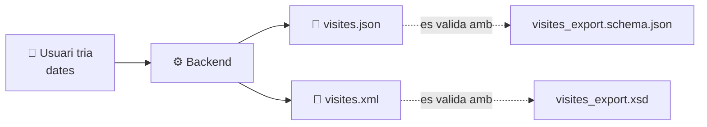

# 🏥 Gestió Hospitalària — Projecte Intermodular

**Base de Dades · Programació · XML/JSON · Alta disponibilitat**
ASIX M372 · M377 · M0003 · M0373 — Curs 25/26 · 1r ASIX

**Autors:** Eric Lopez, Nil Parra


> Projecte acadèmic desenvolupat i provat en local amb **dades de prova**. No conté ni ha contingut mai dades reals de pacients.

---

## Índex

1. [Què és aquest projecte?](#1-què-és-aquest-projecte)
2. [Visió general](#2-visió-general)
3. [Com funciona una consulta pas a pas](#3-com-funciona-una-consulta-pas-a-pas)
4. [Qui pot veure què: rols i protecció de dades](#4-qui-pot-veure-què-rols-i-protecció-de-dades)
5. [Infraestructura i alta disponibilitat](#5-infraestructura-i-alta-disponibilitat)
6. [Còpies de seguretat](#6-còpies-de-seguretat)
7. [La base de dades](#7-la-base-de-dades)
8. [Funcionalitats de l'aplicació](#8-funcionalitats-de-laplicació)
9. [Dashboard Power BI](#9-dashboard-power-bi)
10. [Glossari](#10-glossari)
11. [Documentació tècnica](#11-documentació-tècnica)
12. [Instal·lació i execució](#12-installació-i-execució)

---

## 1. Què és aquest projecte?

És una **aplicació per gestionar el dia a dia d'un hospital**: el personal (metges, infermers, administratius…), els pacients, les visites, les habitacions, els quiròfans i els aparells mèdics.

En poques paraules:

| Pregunta | Resposta |
|---|---|
| **Qui la fa servir?** | El personal de l'hospital, cadascú amb els permisos que li toquen segons la seva feina. |
| **Què permet fer?** | Donar d'alta pacients i personal, consultar informes (visites del dia, ocupació d'habitacions, quiròfans…) i exportar dades. |
| **On es guarden les dades?** | En una base de dades PostgreSQL, que es replica en un segon servidor per si el primer falla. |
| **Com es protegeixen?** | Contrasenyes xifrades, permisos per rol i dades personals (DNI, telèfon, email…) amagades parcialment per a qui no les necessita veure. |
| **I si cau el servidor?** | Un script detecta la caiguda i activa automàticament el servidor de reserva al núvol. |
| **I si es perden dades?** | Hi ha còpies de seguretat setmanals i diàries, guardades al servidor i a Google Drive. |

---

## 2. Visió general

El projecte té **tres maneres d'accedir a les dades**, totes connectades a la mateixa base de dades:



- **Aplicació d'escriptori:** és la interfície principal. El personal hi entra amb el seu usuari i hi fa les gestions i consultes.
- **Web:** ofereix el login, el registre i els formularis d'alta des del navegador.
- **Backend (Flask):** és el "cervell". Rep les peticions, comprova qui és l'usuari, consulta la base de dades i retorna la resposta amb les dades sensibles protegides.
- **Base de dades (PostgreSQL):** guarda tota la informació de l'hospital.
- **Power BI:** llegeix directament unes vistes preparades de la base de dades per mostrar gràfics i indicadors, amb un usuari que **només pot llegir**.

---

## 3. Com funciona una consulta pas a pas

Exemple: un metge entra a l'aplicació i consulta la llista de pacients.



Hi ha **dues capes de protecció**:

1. **A la base de dades:** cada consulta s'executa amb el rol de l'usuari (`SET ROLE`), de manera que PostgreSQL només deixa accedir a les taules permeses per a aquella feina.
2. **Al backend:** abans d'enviar la resposta, s'amaguen parcialment les dades personals si l'usuari no és administrador.

---

## 4. Qui pot veure què: rols i protecció de dades

### Rols segons la feina

Quan es registra un usuari nou, un **trigger** de la base de dades li crea automàticament un rol de PostgreSQL segons la seva feina. Així ningú ha d'assignar permisos a mà.



A més, tots els rols de la plantilla (excepte l'administrador) hereten el grup `personal`, que dona accés de lectura a les dades comunes.

### Emmascarament de dades personals

Les dades més sensibles es guarden senceres a la base de dades, però **només els administradors les veuen completes**. La resta del personal en veu una versió parcial, suficient per identificar la persona però no per copiar-ne les dades.

| Dada | Ho veu un administrador | Ho veu la resta del personal |
|---|---|---|
| DNI | `12345678A` | `12*****8A` |
| Telèfon | `612345678` | `612****78` |
| Email | `joan.garcia@exemple.cat` | `j***@exemple.cat` |
| Data de naixement | `1985-04-12` | `****-**-**` |

*(Valors d'exemple, no reals.)*

---

## 5. Infraestructura i alta disponibilitat

### La idea

Un hospital no es pot quedar sense sistema. Per això la proposta fa servir **dos servidors**:

- **Servidor principal (local)**, dins de l'hospital. És el que treballa normalment.
- **Servidor de reserva (cloud)**, al núvol. Té una còpia de la base de dades sempre actualitzada i està preparat per prendre el relleu.

És com tenir un **generador d'emergència**: normalment no s'utilitza, però si cau la llum, s'engega sol.



### Com es mantenen sincronitzats

PostgreSQL apunta cada canvi en uns fitxers anomenats **WAL** (*Write-Ahead Log*), una mena de **diari de tot el que passa** a la base de dades. El servidor de reserva va llegint aquest diari i aplica els mateixos canvis, de manera que sempre té les dades al dia.

1. Algú desa una dada (per exemple, una visita nova).
2. PostgreSQL l'apunta al seu registre WAL.
3. Els fitxers WAL es passen a la carpeta `archive`.
4. Aquesta carpeta està compartida amb el servidor cloud per **NFS**, a través de la VPN.
5. El servidor cloud aplica els canvis a la seva còpia.

### Per què una VPN (Tailscale)?

El servidor local està darrere del router de l'operador (NAT) i d'un firewall, així que des del núvol no s'hi pot connectar directament. Es van valorar tres opcions:

| Opció | Resultat |
|---|---|
| Túnel TCP amb Ngrok | ❌ Descartat: limitat i probablement de pagament |
| Túnel SSH | ❌ Descartat: possible inestabilitat |
| **VPN Tailscale** | ✅ Escollida: estable, gratuïta i open source |

Tailscale crea una **xarxa privada xifrada** entre els dos servidors, com si estiguessin a la mateixa oficina. Més detalls a [`extras/tailscale_doc.md`](extras/tailscale_doc.md).

### Què passa si cau el servidor principal (failover)



La prova de concepte es va fer apagant PostgreSQL al servidor principal i comprovant que el servidor cloud es promocionava sol a primari.

### Maquinari proposat

| | Servidor principal (local) | Servidor de reserva (cloud) |
|---|---|---|
| CPU | 8 vCPU | 6 vCPU |
| RAM | 32 GB | 16 GB |
| Disc | 1 TB SSD NVMe en RAID 1 | 1 TB SSD NVMe |
| Sistema | Ubuntu Server 24.04 LTS | Ubuntu Server 24.04 LTS |
| Aplicació | Activa | Activa (actiu-actiu) |
| Base de dades | Primària | Rèplica (actiu-passiu) |

El document complet és a [`extras/Disseny model alta disponibilitat.pdf`](extras/Disseny%20model%20alta%20disponibilitat.pdf).

---

## 6. Còpies de seguretat

La replicació protegeix si **cau un servidor**, però no si algú **esborra dades per error** (l'esborrat també es replicaria). Per això també hi ha còpies de seguretat.



- **Còpia completa setmanal:** el cap de setmana a les 02:00, l'hora de menys activitat. Es guarda al servidor i a Google Drive.
- **Còpia diària dels WAL:** cada matinada, amb els canvis del dia. Permet recuperar fins a l'últim dia.
- Tot s'executa automàticament amb **cron** i scripts de Python ([`scripts/backups/`](scripts/backups/)).

### Pla de recuperació

Si cal recuperar dades, el procediment és:

1. Restaurar la còpia completa de la setmana.
2. Revisar els logs per trobar el moment del problema.
3. Aplicar els fitxers WAL fins just abans d'aquell moment.

Així es pot tornar la base de dades a l'estat exacte que tenia **just abans de l'error**.

---

## 7. La base de dades

La base de dades modela l'hospital amb 19 taules. Aquest és un resum de les relacions principals:



El diagrama entitat-relació complet:

<p align="center">
  
</p>

Fitxers editables a [`database/design/`](database/design/) (`.drawio` i `.pdf`).

---

## 8. Funcionalitats de l'aplicació

### Aplicació d'escriptori (Tkinter)

| Gestió | Informes |
|---|---|
| 🔐 Login | 🏢 Informe per planta |
| 🏠 Pantalla principal | 👥 Informe de personal |
| ➕ Alta de pacient | 📅 Visites per dia |
| ➕ Alta de personal | 📋 Informe de visites (exportació JSON/XML) |
| | 🔪 Informe de quiròfans |
| | 🩺 Informe d'aparells |
| | 🧑‍🏫 Informe de supervisió |
| | 🛏️ Informe d'habitacions |
| | 👨‍⚕️ Informe de metge |
| | 🦠 Malalties més comunes |
| | 🏆 Rànquing de metges |
| | 🧾 Informe de pacient |

### Exportació de dades (XML / JSON)

L'informe de visites permet **descarregar les visites d'un rang de dates** en format JSON o XML, juntament amb els esquemes que en defineixen l'estructura (JSON Schema i XSD). Això permet que **altres sistemes** puguin llegir i validar les dades automàticament.



### Web

El backend també serveix pàgines web per a: login, registre d'usuari (vinculat a un `id_intern` de `personal`), pantalla principal i formularis d'alta de pacient i de personal.

---

## 9. Dashboard Power BI

Per a la direcció de l'hospital, un dashboard de Power BI mostra indicadors com:

- Visites per àrea, per metge i per franja horària
- Ocupació d'habitacions
- Activitat dels quiròfans
- Malalties més diagnosticades
- Recursos humans per planta

Power BI es connecta **directament a PostgreSQL** amb l'usuari `powerbi_reader`, que **només pot llegir** unes vistes preparades (`vw_dashboard_*`). No pot veure ni modificar la resta de taules. Detalls a [`dashboard/README.md`](dashboard/README.md).

---

## 10. Glossari

| Terme | Explicació senzilla |
|---|---|
| **Backend** | La part del programa que no es veu: rep les peticions, aplica les regles i parla amb la base de dades. |
| **API REST** | La "finestreta" per on l'aplicació demana dades al backend (per exemple, `GET /api/pacients`). |
| **Base de dades** | On es guarda tota la informació de manera ordenada en taules. |
| **Rol** | Un conjunt de permisos. Cada usuari té el rol de la seva feina. |
| **Trigger** | Una acció automàtica de la base de dades que s'executa quan passa alguna cosa (per exemple, en registrar un usuari). |
| **Emmascarament** | Amagar part d'una dada (`12*****8A`) perquè no es pugui veure sencera. |
| **bcrypt** | Mètode per guardar contrasenyes de manera que ni tan sols l'administrador les pugui llegir. |
| **WAL** | El "diari" on PostgreSQL apunta cada canvi. Serveix per replicar i per recuperar dades. |
| **Rèplica / standby** | Una còpia de la base de dades en un altre servidor, sempre actualitzada i preparada per substituir l'original. |
| **Failover** | El canvi automàtic al servidor de reserva quan el principal falla. |
| **VPN** | Un túnel xifrat que connecta dos equips per internet com si fossin a la mateixa xarxa. |
| **NFS** | Un sistema per compartir carpetes entre servidors per la xarxa. |
| **cron** | El programador de tasques de Linux: executa scripts a hores fixes o cada X minuts. |
| **XSD / JSON Schema** | "Plantilles" que defineixen com ha de ser un fitxer XML o JSON perquè sigui vàlid. |

---

## 11. Documentació tècnica

### Estructura del projecte

```
Projecte-hospital/
├── iniciar.py                  # Arrenca el servidor i el client d'un sol cop
├── requirements.txt            # Dependències Python
├── .env.example                # Plantilla de variables d'entorn
├── server/
│   ├── main.py                 # Backend Flask (API REST + web)
│   ├── tools/
│   │   ├── db_driver.py        # Connexió a PostgreSQL i SET ROLE per usuari
│   │   ├── manager.py          # Login, registre i lògica de dades
│   │   ├── crypt.py            # Xifratge de contrasenyes amb bcrypt
│   │   ├── masking.py          # Emmascarament de dades sensibles per rol
│   │   └── dummydata.py        # Dades de prova per als informes
│   ├── html/  ·  css/          # Frontend web
│   ├── sql/                    # Consultes dels informes i exportacions
│   ├── schemas/                # JSON Schema i XSD de l'exportació de visites
│   └── uploads/                # Fitxers pujats (CV de metges)
├── client/
│   ├── desktop_main.py         # Punt d'entrada del client d'escriptori
│   └── desktop/                # App Tkinter: client API, tema i pantalles (views/)
├── database/
│   ├── design/                 # Diagrama ER (.drawio, .pdf, .png)
│   └── sql/                    # Esquema, funcions, trigger, vistes, seguretat i dades de prova
├── scripts/
│   ├── backups/                # Còpies completes i WAL amb pujada a Google Drive
│   └── crash/                  # Detecció de caiguda i failover
├── dashboard/                  # Dashboard Power BI i instruccions
├── extras/                     # Disseny d'alta disponibilitat i documentació de Tailscale
├── entrega_final/              # Documentació i manual d'usuari en PDF/DOCX
└── testing/                    # Exportacions d'exemple en XML/JSON
```

> Els scripts de `scripts/` són còpies de referència: els originals s'executen als servidors.

### Funcions i trigger SQL

- **`afegir_metge(...)`** i **`afegir_infermer(...)`** ([`funcions_metge_infermer.sql`](database/sql/funcions_metge_infermer.sql)): insereixen a `personal` i a `metge`/`enfermer` (i `supervisio`) en una sola transacció.
- **`trigger_create_con_rol`** ([`trigger_usuari.sql`](database/sql/trigger_usuari.sql)): en inserir a `usuaris`, llegeix el `tipus_feina` del personal associat, crea un rol de PostgreSQL per a l'usuari i li assigna el rol funcional corresponent.

### Esquema de seguretat

Definit a [`database/sql/esquemadeseguretat.sql`](database/sql/esquemadeseguretat.sql):

| Rol | Tipus | Permisos |
|---|---|---|
| `hosp_admin` | Tècnic | Administració completa de taules i seqüències (DDL) |
| `hosp_app` | Tècnic | Usuari del backend: llegir, inserir i actualitzar |
| `administrador` | Grup | Control total |
| `personal` | Grup | Lectura base de dades comunes |
| `sanitari`, `gestio`, `serveis` | Grup | Perfils específics de la plantilla |
| `pacient` | Grup | Preparat per a accés restringit amb vistes o RLS |
| `rol_*` | Login | Un per tipus de feina (metge, infermer, administratiu…) |
| `powerbi_reader` | Login | Només `SELECT` sobre les vistes `vw_dashboard_*` |

Les operacions DDL no es fan mai des de l'aplicació, sinó des del compte d'administració.

### Endpoints del backend

**Autenticació:** `POST /api/login` · `POST /api/logout` · `POST /api/register` · `GET /me`

**Alta de dades:** `POST /api/pacients` · `POST /api/personal`

**Consultes:**

- `GET /api/metges` · `GET /api/pacients` · `GET /api/habitacions`
- `GET /api/informes/planta` · `/personal` · `/malalties` · `/ranking_metges` · `/supervisio` · `/aparells`
- `GET /api/informes/visites_dia?date=YYYY-MM-DD`
- `GET /api/informes/visites?date=YYYY-MM-DD` o `?start_date=…&end_date=…`
- `GET /api/informes/quirofans?date=YYYY-MM-DD`
- `GET /api/informes/habitacions?habitacio=NUM`
- `GET /api/informes/metge?metge=ID&date=YYYY-MM-DD`
- `GET /api/informes/pacient?pacient=ID`

**Exportació de visites:**

- `GET /api/exportacions/visites/json?start_date=…&end_date=…`
- `GET /api/exportacions/visites/xml?start_date=…&end_date=…`
- `GET /api/exportacions/visites/schema/json`
- `GET /api/exportacions/visites/schema/xml`

Cada visita exportada inclou `id_visita`, `dia`, `metge` i un bloc `pacient` amb `id_pacient`, `nom`, `cognom` i `cognom2`.

### Vistes del dashboard

Definides a [`database/sql/dashboard_views.sql`](database/sql/dashboard_views.sql): `vw_dashboard_visites_area_dia`, `vw_dashboard_visites_metge_dia`, `vw_dashboard_visites_franja_dia`, `vw_dashboard_ocupacio_habitacions_dia`, `vw_dashboard_quirofans_dia`, `vw_dashboard_malalties_dia`, `vw_dashboard_planta_recursos` i `vw_dashboard_visites_detall`.

### Dependències Python

| Paquet | Ús |
|---|---|
| `Flask` | Backend web i API REST |
| `psycopg2-binary` | Connexió a PostgreSQL |
| `python-dotenv` | Lectura del fitxer `.env` |
| `requests` | Peticions HTTP del client Tkinter al backend |
| `gunicorn` | Servidor WSGI per a producció |
| `bcrypt` | Xifratge de contrasenyes |
| `Faker` | Generació de dades de prova |

### Variables d'entorn

Cal un fitxer `.env` a l'arrel del projecte (o a `server/`). Es pot crear a partir de la plantilla `.env.example` (`cp .env.example .env`) i omplir-ne els valors. El `.env` no es puja al repositori.

| Variable | Descripció | Valor per defecte |
|---|---|---|
| `FLASK_USE_SSL` | Activa SSL al backend | `false` |
| `FLASK_HOST` | Host de Flask | `127.0.0.1` |
| `FLASK_PORT` | Port de Flask | `5000` |
| `FLASK_SECRET` | Clau secreta per a les sessions Flask | — |
| `DESKTOP_API_BASE_URL` | URL base del client desktop | `http://127.0.0.1:5000` |
| `DESKTOP_API_VERIFY_TLS` | Verifica certificat TLS al client desktop | `false` |
| `DB_HOST` | Adreça del servidor PostgreSQL | — |
| `DB_PORT` | Port de PostgreSQL o PgBouncer | `5432` |
| `DB_DATABASE` | Nom de la base de dades | `hosp_blanes` |
| `DB_USER` | Usuari de connexió a PostgreSQL | — |
| `DB_PASSWORD` | Contrasenya de l'usuari de PostgreSQL | — |
| `DB_SSLMODE` | Mode SSL de PostgreSQL | `prefer` |

### Certificat SSL

El backend suporta SSL amb `FLASK_USE_SSL=true` (i `CERT` / `KEY`). En producció, el certificat s'hauria de generar amb certbot i renovar automàticament amb cron. En local és habitual `FLASK_USE_SSL=false`.

---

## 12. Instal·lació i execució

### Requisits

- Python 3.10 o superior
- PostgreSQL instal·lat i en marxa
- Fitxer `.env` configurat (vegeu [Variables d'entorn](#variables-dentorn))

### 1. Instal·lar dependències

```bash
pip install -r requirements.txt
cp .env.example .env   # i omplir-ne els valors
```

### 2. Preparar la base de dades (primera vegada)

Executa els fitxers SQL en aquest ordre:

```bash
psql -U hosp_admin -d hosp_blanes -f database/sql/implementacio.sql
psql -U hosp_admin -d hosp_blanes -f database/sql/funcions_metge_infermer.sql
psql -U hosp_admin -d hosp_blanes -f database/sql/trigger_usuari.sql
psql -U hosp_admin -d hosp_blanes -f database/sql/dashboard_views.sql
psql -U hosp_admin -d hosp_blanes -f database/sql/esquemadeseguretat.sql
psql -U hosp_admin -d hosp_blanes -f database/sql/test_data.sql
```

Si `esquemadeseguretat.sql` s'havia executat abans de crear les vistes del dashboard, torna'l a executar per aplicar els permisos de `powerbi_reader`.

### 3. Arrencar l'aplicació

**Opció 1 — inici ràpid (recomanat):**

```bash
python iniciar.py
```

Arrenca el servidor Flask i el client Tkinter d'un sol cop. En tancar la finestra del client, el servidor s'atura automàticament.

**Opció 2 — manual, en dues terminals:**

```bash
# Terminal 1: backend
cd server
python main.py

# Terminal 2: client d'escriptori
cd client
python desktop_main.py
```

---

## Documentació addicional

- 📘 [Manual d'usuari](entrega_final/manual_usuari_hospital_tenso.pdf)
- 📗 [Documentació del projecte](entrega_final/documentacio_hospital_tenso.pdf)
- 🏗️ [Disseny d'alta disponibilitat](extras/Disseny%20model%20alta%20disponibilitat.pdf)
- 🔒 [Instal·lació de Tailscale](extras/tailscale_doc.md)
- 📊 [Dashboard Power BI](dashboard/README.md)

## Llicència

Distribuït sota la llicència [MIT](LICENSE).
